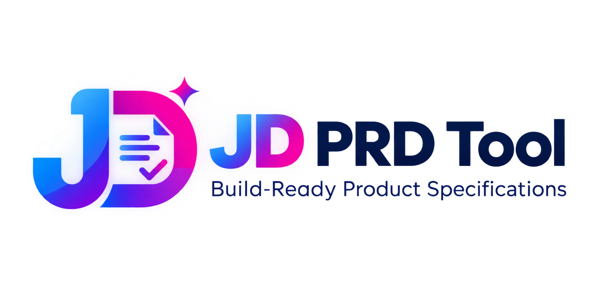

# JD PRD Tool

**Build-Ready Product Specifications**

JD PRD Tool is a web application concept for turning structured product
ideas into implementation-ready Product Requirements Documents (PRDs).
Users work through guided steps and feature sub-steps, then generate and
export a documentation package for their project.

> **Project status:** This README is a repository-ready project
> blueprint. Update the implementation-specific details, screenshots,
> deployed URL, and scripts to match the code that is actually present
> in your repository.

## Table of Contents

-   [Overview](#overview)
-   [Core Features](#core-features)
-   [User Workflow](#user-workflow)
-   [Suggested Technology Stack](#suggested-technology-stack)
-   [Repository Structure](#repository-structure)
-   [Getting Started](#getting-started)
-   [Environment Variables](#environment-variables)
-   [Firebase Setup](#firebase-setup)
-   [AI Provider Setup](#ai-provider-setup)
-   [Credits and Usage Rules](#credits-and-usage-rules)
-   [PRD Export Package](#prd-export-package)
-   [Security](#security)
-   [Accessibility and Responsive
    Design](#accessibility-and-responsive-design)
-   [Testing and Quality Checks](#testing-and-quality-checks)
-   [Deployment](#deployment)
-   [Troubleshooting](#troubleshooting)
-   [Roadmap](#roadmap)
-   [Contributing](#contributing)
-   [License](#license)

## Overview

JD PRD Tool helps builders plan software before implementation. Instead
of starting with a blank document, users describe a product, complete
guided planning steps, add features and sub-features, and produce
structured documentation that can be used by developers or AI coding
agents.

### Product goals

-   Make PRD creation approachable for people with little or no coding
    experience.
-   Break a large product idea into manageable steps and sub-steps.
-   Keep each user's projects and progress private to their account.
-   Apply a credit allowance to AI-assisted generation.
-   Export a clean documentation package that can be stored in GitHub or
    shared with a development team.
-   Provide a polished, responsive interface with light and dark themes.

## Core Features

### Public and account pages

-   Welcome / landing page describing the product.
-   Sign up and sign in.
-   Google sign-in when enabled in Firebase.
-   Password reset and authentication error states.
-   Protected dashboard for authenticated users.

### Dashboard

-   Welcome panel and remaining-credit indicator.
-   Project count, completed PRDs, and drafts.
-   Recent projects with status and progress.
-   Quick-start guidance.
-   PRD templates for common project types.
-   Responsive navigation and profile menu.

### PRD builder

-   Create a new project and provide its name, purpose, audience, and
    goals.
-   Complete guided planning stages before generation.
-   Add, edit, reorder, and remove features.
-   Add sub-features, acceptance criteria, constraints, and
    implementation notes.
-   Save progress so a user can return later.
-   Validate required fields and show completion status.
-   Preview the generated content before exporting.

### Project management

-   View, search, filter, and sort projects.
-   Open, edit, duplicate, archive, or delete a project.
-   Track draft, in-progress, and completed states.
-   Show progress and last-updated time.
-   Confirm destructive actions before deleting data.

### Appearance and usability

-   Light and dark theme switch.
-   Responsive layouts for desktop, tablet, and mobile.
-   Clear loading, empty, success, and error states.
-   Accessible keyboard focus and form labels.
-   Consistent spacing, typography, and reusable UI components.

## User Workflow

1.  **Create an account** or sign in.
2.  **Open the dashboard** and review the available credits.
3.  **Create a project** and enter the initial product details.
4.  **Complete the planning stages** and required sub-steps.
5.  **Review features and requirements** for completeness.
6.  **Generate the PRD** through the configured AI provider.
7.  **Review and edit the result** before finalizing it.
8.  **Export the documentation package** and save it to the project
    repository.

The application should clearly explain which fields are required and why
generation is unavailable when required steps remain incomplete.

## Suggested Technology Stack

Adjust this list to match the dependencies in `package.json`.

  Area             Suggested technology
  ---------------- ---------------------------------------------------
  Frontend         React
  Build tool       Vite
  Language         JavaScript / JSX or TypeScript
  Styling          CSS modules, plain CSS, or Tailwind CSS
  Authentication   Firebase Authentication
  Database         Cloud Firestore
  AI generation    Server-side API route or trusted backend function
  Hosting          Vercel or another compatible static/web host
  Source control   Git and GitHub

## Repository Structure

A suggested structure for a React application:

``` text
jd-prd-tool/
├── public/
│   ├── favicon.svg
│   ├── logo.svg
│   └── screenshots/
│       ├── dashboard.png
│       ├── project-builder.png
│       └── export-preview.png
├── src/
│   ├── assets/
│   ├── components/
│   │   ├── common/
│   │   ├── dashboard/
│   │   ├── forms/
│   │   └── layout/
│   ├── pages/
│   │   ├── LandingPage.jsx
│   │   ├── LoginPage.jsx
│   │   ├── RegisterPage.jsx
│   │   ├── DashboardPage.jsx
│   │   ├── ProjectsPage.jsx
│   │   ├── TemplatesPage.jsx
│   │   ├── BuilderPage.jsx
│   │   └── SettingsPage.jsx
│   ├── services/
│   │   ├── firebase.js
│   │   ├── authService.js
│   │   ├── projectService.js
│   │   ├── creditService.js
│   │   └── prdService.js
│   ├── hooks/
│   ├── utils/
│   │   ├── validation.js
│   │   └── exportPrd.js
│   ├── styles/
│   ├── App.jsx
│   └── main.jsx
├── functions/                 # Optional trusted server functions
├── .env.example
├── .gitignore
├── firebase.json              # If Firebase Hosting/Emulators are used
├── firestore.rules
├── firestore.indexes.json
├── package.json
├── README.md
└── vite.config.js
```

This is an example layout, not a claim that every listed file already
exists. Keep the repository structure aligned with the actual
implementation.

## Getting Started

### Prerequisites

Install the following before running the project:

-   Node.js LTS
-   npm (included with Node.js) or another package manager supported by
    the project
-   Git
-   A Firebase project if Firebase services are enabled
-   An AI provider account if AI generation is enabled

Check installed versions:

``` bash
node --version
npm --version
git --version
```

### 1. Clone the repository

Replace the placeholder URL with your actual GitHub repository URL.

``` bash
git clone https://github.com/YOUR-USERNAME/YOUR-REPOSITORY.git
cd YOUR-REPOSITORY
```

### 2. Install dependencies

``` bash
npm install
```

### 3. Configure environment variables

Create a local `.env` file using `.env.example` as a reference. Never
commit real credentials.

``` bash
cp .env.example .env
```

Fill in the values for the services used by your implementation.

### 4. Start the development server

For a typical Vite project:

``` bash
npm run dev
```

Open the local URL printed by Vite in your terminal.

### 5. Run available checks

``` bash
npm run build
npm run lint
npm test
```

Run only scripts that are defined in your `package.json`. If a command
is not configured, add the relevant script or omit that command.

## Environment Variables

The following is an example for a Vite + Firebase application. Use only
variables that your code actually reads.

Create `.env.example`:

``` dotenv
# Firebase web app configuration
VITE_FIREBASE_API_KEY=
VITE_FIREBASE_AUTH_DOMAIN=
VITE_FIREBASE_PROJECT_ID=
VITE_FIREBASE_STORAGE_BUCKET=
VITE_FIREBASE_MESSAGING_SENDER_ID=
VITE_FIREBASE_APP_ID=

# Optional public application URL
VITE_APP_URL=http://localhost:5173

# Do not place private AI provider keys in VITE_* variables.
# Configure AI secrets in a trusted server environment instead.
```

**Important:** Vite exposes variables prefixed with `VITE_` to the
browser bundle. Never put private API keys, service-account JSON,
database passwords, or privileged server credentials in client-side
environment variables.

## Firebase Setup

### 1. Create a Firebase project

1.  Open the Firebase Console.
2.  Create a project or select an existing project.
3.  Register a web app.
4.  Copy its web configuration into your local environment file.

### 2. Enable authentication

In Firebase Authentication, enable the providers used by the app, such
as:

-   Email and password
-   Google sign-in

Configure authorized domains for local development and production.
Handle cancelled sign-in, invalid credentials, and network errors in the
UI.

### 3. Create the Firestore database

Create a Cloud Firestore database and define collections that match your
data model. A possible starting point is:

``` text
users/{userId}
projects/{projectId}
creditLedger/{entryId}
```

Possible user fields:

``` text
displayName
email
photoURL
createdAt
updatedAt
creditsRemaining
```

Possible project fields:

``` text
ownerId
name
description
status
features
planningProgress
generatedPrd
createdAt
updatedAt
```

These are suggested fields. Validate the final schema against the
application code before deploying.

### 4. Secure Firestore

Use Firebase Authentication and Firestore Security Rules to restrict
user-owned records. Do not rely only on hiding UI controls.

Illustrative rule pattern for owner-only project access (adapt to your
actual schema and test before deployment):

``` javascript
rules_version = '2';

service cloud.firestore {
  match /databases/{database}/documents {
    function signedIn() {
      return request.auth != null;
    }

    match /projects/{projectId} {
      allow read, update, delete:
        if signedIn() && resource.data.ownerId == request.auth.uid;

      allow create:
        if signedIn()
        && request.resource.data.ownerId == request.auth.uid;
    }
  }
}
```

This example is not a complete production ruleset. Add schema
validation, field-level restrictions, and rules for every collection. Do
not deploy permissive rules such as `allow read, write: if true`.

### 5. Credit accounting

If credits are used to meter AI generation, enforce deductions in a
trusted server function or backend transaction. A browser-only credit
counter can be modified by a user and must not be treated as
authoritative.

## AI Provider Setup

AI generation should run through a trusted backend endpoint or
serverless function.

Recommended request flow:

1.  The authenticated client submits the project ID and completed
    planning data.
2.  The backend verifies the user's identity.
3.  The backend loads the authoritative project and credit balance.
4.  The backend validates completion requirements and request size.
5.  The backend reserves or deducts credits safely.
6.  The backend calls the configured AI provider using a server-side
    secret.
7.  The backend validates and stores the generated PRD.
8.  The client receives the result and an updated credit balance.

Store provider secrets in the deployment platform's server-side
environment settings. Do not expose secret keys in React components,
browser bundles, GitHub commits, or public logs.

The actual AI provider, model, pricing, and generation endpoint depend
on the implementation and must be documented once configured.

## Credits and Usage Rules

The intended product plan includes **300 starter credits per user**.
Confirm the production policy before launch.

Recommended safeguards:

-   Assign starter credits through a trusted account-creation flow.
-   Store the authoritative balance in a protected database record.
-   Deduct credits only on the server.
-   Use atomic transactions or idempotency keys to prevent duplicate
    deductions.
-   Define what happens when generation fails or is retried.
-   Display remaining credits and explain the cost before generation.
-   Prevent users from submitting requests when the balance is
    insufficient.
-   Keep an auditable credit ledger for support and debugging.
-   Never trust a credit amount submitted by the browser.

The credit cost per generation and any refill policy should be
explicitly defined in the product settings.

## PRD Export Package

The planned export workflow produces a ZIP containing four documentation
files. Confirm the exact filenames and contents in the implementation. A
suggested package is:

``` text
project-prd-export.zip
├── PRD.md
├── README.md
├── TECHNICAL_SPECIFICATION.md
└── IMPLEMENTATION_PLAN.md
```

Suggested content:

-   **PRD.md** --- product goals, user stories, requirements, workflows,
    and acceptance criteria.
-   **README.md** --- project overview, setup instructions, and usage.
-   **TECHNICAL_SPECIFICATION.md** --- architecture, data model,
    integrations, and technical constraints.
-   **IMPLEMENTATION_PLAN.md** --- milestones, tasks, dependencies, and
    validation checklist.

The export should use valid Markdown, descriptive filenames, UTF-8 text,
and clear error handling. Let users preview the files before downloading
the ZIP.

## Security

Before deploying publicly:

-   Keep API keys and privileged credentials out of the client bundle
    and Git history.
-   Use Firebase Authentication for protected account features.
-   Enforce ownership and validation in Firestore Security Rules.
-   Perform AI calls and credit accounting on the server.
-   Validate all client input on both client and server.
-   Apply rate limits and sensible request-size limits to generation
    endpoints.
-   Avoid logging passwords, tokens, private user content, or provider
    secrets.
-   Provide safe error messages without exposing internal stack traces.
-   Review account deletion, data retention, and privacy requirements.
-   Add abuse monitoring and cost controls for AI usage.

If a secret is accidentally committed, revoke or rotate it immediately;
deleting the file in a later commit does not remove it from Git history.

## Accessibility and Responsive Design

Recommended interface standards:

-   Use semantic headings and landmarks.
-   Give every input a visible label.
-   Ensure keyboard access and visible focus indicators.
-   Provide adequate color contrast in light and dark themes.
-   Do not communicate status through color alone.
-   Respect reduced-motion preferences.
-   Support common desktop, tablet, and mobile viewport widths.
-   Keep forms usable on small screens and show actionable validation
    messages.

## Testing and Quality Checks

Test the critical workflows before each release:

-   Registration, sign-in, Google sign-in, sign-out, and password reset.
-   Protected-route access and expired sessions.
-   Creating, editing, and deleting a project.
-   Saving and restoring builder progress.
-   Validation of incomplete feature steps.
-   Credit balance, concurrent requests, failed generation, and retries.
-   Generated PRD content and ZIP file integrity.
-   Ownership rules for users attempting to access another user's data.
-   Light/dark theme persistence, keyboard navigation, and responsive
    layouts.

Use unit tests for validation and credit-related logic, integration
tests for backend services, and end-to-end tests for essential user
journeys where practical.

## Deployment

### Vercel or another compatible host

1.  Push the project to GitHub.
2.  Import the repository into your hosting provider.
3.  Set the correct framework preset and build command for the project.
4.  Add the required public environment variables.
5.  Configure server-side AI secrets separately from browser variables.
6.  Add the production domain to Firebase Authentication's authorized
    domains.
7.  Deploy and test authentication, saving, generation, and export on
    the production URL.

For a typical Vite app, the build command is:

``` bash
npm run build
```

The output directory is commonly `dist`, unless the project
configuration specifies otherwise.

### Pre-launch checklist

-   [ ] Production environment variables are configured.
-   [ ] Authentication providers and domains are configured.
-   [ ] Firestore rules are reviewed and tested.
-   [ ] AI secrets are server-side only.
-   [ ] Credit deductions are authoritative and safe under retries.
-   [ ] Empty, loading, success, and error states work.
-   [ ] ZIP exports contain the expected files.
-   [ ] Mobile and desktop layouts have been checked.
-   [ ] Privacy and support information is available.
-   [ ] No credentials or personal data are committed to GitHub.

## Troubleshooting

### Firebase configuration errors

-   Verify the Firebase project ID and web app configuration.
-   Check that all required environment variables are present.
-   Restart the development server after changing `.env`.
-   Confirm the production domain is authorized in Firebase
    Authentication.

### Sign-in does not work

-   Confirm the authentication provider is enabled.
-   Inspect the browser console and Firebase Authentication logs.
-   Check authorized domains and OAuth configuration.
-   Ensure protected routes handle loading and signed-out states.

### AI generation fails

-   Confirm the backend endpoint is deployed and reachable.
-   Check server logs for provider errors without exposing secrets.
-   Verify the provider key is configured in the server environment.
-   Check rate limits, request size, and available credits.
-   Ensure the project has completed all required planning steps.

### ZIP download is empty or incomplete

-   Confirm all four files are generated before packaging.
-   Validate the ZIP generation logic and browser download response.
-   Check that generated Markdown is non-empty and encoded as UTF-8.
-   Add an error state when packaging or downloading fails.

## Roadmap

Potential improvements:

-   [ ] More PRD templates and reusable feature libraries.
-   [ ] Autosave and draft recovery.
-   [ ] Duplicate project and template workflows.
-   [ ] PRD version history and comparison.
-   [ ] Export customization and downloadable ZIP previews.
-   [ ] Team collaboration and sharing permissions.
-   [ ] Usage analytics and administrative credit management.
-   [ ] Additional languages and accessibility improvements.
-   [ ] Automated end-to-end regression tests.

## Contributing

Contributions are welcome when they improve reliability, usability,
accessibility, or documentation.

1.  Fork the repository.
2.  Create a branch for your change.
3.  Keep changes focused and follow existing code conventions.
4.  Run the available checks.
5.  Open a pull request with a clear description and test notes.

Do not include secrets, production user data, or private configuration
files in commits.

## License

Add the license that applies to this repository before publishing it for
reuse. If no license file is present, the repository should not be
assumed to grant permission to redistribute or modify the code.

------------------------------------------------------------------------

**JD PRD Tool --- Build your idea. Define every feature. Generate
build-ready documentation.**
